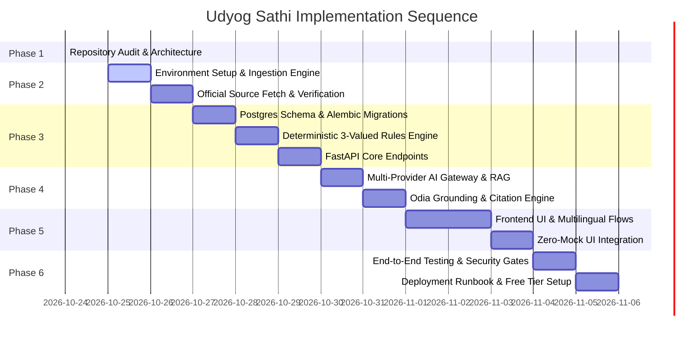

# Architecture Gap Analysis & Technical Risk Assessment

> **Project:** Udyog Sathi  
> **Phase:** Phase 1 — Repository Audit  
> **Baseline Date:** October 24, 2026  

---

## 1. Current State vs. Target State Matrix

| Architectural Domain | Current State (Inspected Baseline) | Target State (Production Architecture) | Gap Severity | Primary Remediation Action |
|---|---|---|---|---|
| **Repository & Codebase Layout** | Root workspace contains prompt pack and documentation only; no source code tree. | Modular monorepo with `apps/api` (FastAPI), `apps/web` (Next.js/React), `services/`, `data/`, `docs/`, `tests/`. | High | Scaffold repository directory structure per `PROJECT_STRUCTURE.md`. |
| **Database & Schema Migrations** | No database configured; Docker daemon inactive; `psql` absent; `SQLAlchemy` installed but no models or `alembic` setup. | PostgreSQL 16 + pgvector with SQLAlchemy 2.0 ORM, Alembic migrations, and schema enforcing strict status lifecycles. | Critical | Install `asyncpg`/`psycopg`, `alembic`, `pgvector`; launch local PostgreSQL or cloud PostgreSQL (Supabase/Neon free tier); create migrations. |
| **Data Ingestion & OCR Pipeline** | No ingestion scripts; Tesseract 5.5.3 installed with `ori`/`hin`/`eng`; `pymupdf` installed; `DATA_SOURCE_REGISTER.md` lists candidate URLs only. | Automated & manual ingestion pipeline: digital PDF parsing via PyMuPDF, OCR fallback via Tesseract, SHA-256 verification, admin review queue. | Critical | Build `services/scheme_ingestion/` with PDF parser, OCR router, and admin approval workflows (Phase 2). |
| **Eligibility Engine** | No rules engine exists. | Pure Python deterministic 3-valued logic engine (`Eligible`, `Likely Eligible`, `Not Eligible`, `Rules Unverified`) with clause-level traceability. | Critical | Build deterministic evaluator and rule parser in `services/eligibility/` (Phase 3). |
| **RAG & AI Integrations** | No RAG pipeline; `groq` and `google-genai` SDKs installed; no environment keys configured in shell; no provider abstraction. | Unified provider adapter (`LLMProvider`) supporting Groq, Gemini, Sarvam, Mistral with bounded timeouts, retries, and citation verification. | High | Build provider gateway in `apps/api/ai/` and vector search pipeline with honest failure states (Phase 4). |
| **Frontend Application** | No `package.json`, React app, or UI code; `npm test` fails with ENOENT. | Accessible, responsive Next.js/React PWA with native Odia font support, search, scheme details, eligibility wizard, and zero mock data. | High | Scaffold web application in `apps/web/`, connect directly to backend API endpoints (Phase 5). |
| **Authentication & RBAC** | No auth system, user session handling, or role enforcement. | Role-Based Access Control (RBAC) with 4 key roles (`entrepreneur`, `facilitator`, `scheme_reviewer`, `platform_admin`) and DPDP consent logging. | Medium | Implement JWT/session auth and role-checking dependencies in FastAPI (Phase 3 & 5). |
| **Test Suites & CI/CD** | `pytest` runs but collects 0 items (exit code 5); no frontend test suite. | Automated test suites: unit tests for rules, integration tests for DB, RAG evaluation on golden questions, lint/type checks. | High | Create `tests/unit/`, `tests/integration/`, and `tests/rag_eval/` with synthetic fixtures isolated from live database (Phase 3–6). |
| **Environment & Secrets** | No `.env` or `.env.example` in repo; 32 required environment variables unset in shell. | Fully documented `.env.example` with variable placeholders; local git-ignored `.env` for secrets. | Medium | Create `.env.example` and safe config loader using `pydantic-settings`. |

---

## 2. Incomplete Features Breakdown

Based on the 15 core features defined in the solution specification (`Udyog_Sathi_MSME_Odisha_Solution.pdf`):

| Feature ID | Feature Name | Implementation Status | Implementation Phase | Blocker / Dependency |
|---|---|---|---|---|
| **F1** | Unified Scheme Catalogue | Not Started | Phase 2 & 3 | Requires database schema, migration, and verified data ingestion. |
| **F2** | Smart Business Profile Builder | Not Started | Phase 3 & 5 | Requires profile schema and frontend wizard. |
| **F3** | AI Eligibility Engine | Not Started | Phase 3 | Requires deterministic rule evaluator and verified rule conditions. |
| **F4** | Document Checklist Generator | Not Started | Phase 3 & 5 | Requires verified document requirement mappings in scheme schemas. |
| **F5** | Multilingual Conversational Agent | Not Started | Phase 4 & 5 | Requires AI provider adapters, RAG pipeline, and API credentials. |
| **F6** | Application Tracker (User-Managed) | Not Started | Phase 3 & 5 | Requires user authentication and tracking tables. |
| **F7** | Recommendation & Benefit Estimator | Not Started | Phase 3 | Requires verified mathematical benefit formulas. |
| **F8** | Content Governance & Verification | Not Started | Phase 2 | Requires admin approval endpoints and audit tables. |
| **F9** | Alerts & Notifications | Not Started | Phase 3 / Post-MVP | Background task queue (Celery/Arq/cron). |
| **F10** | Multimodal Channels (Odia Voice/IVR) | Not Started | Phase 4 / Post-MVP | Depends on Sarvam AI Saarika/Bulbul API access. |
| **F11** | Facilitator Console (CSC / DIC) | Not Started | Phase 5 | Requires ABAC consent delegation. |
| **F12** | Geo-Intelligence & Cluster Insights | Not Started | Phase 3 / Post-MVP | District and industrial cluster mapping data. |
| **F13** | Analytics & Policy Dashboard | Not Started | Phase 5 | Aggregated query endpoints based on real usage data. |
| **F14** | Scheme Update & Versioning Pipeline | Not Started | Phase 2 | Scheme versioning and amendment tracking in database. |
| **F15** | Enterprise RBAC, Audit & Privacy | Not Started | Phase 3 & 6 | FastAPI security dependencies and audit log table. |

---

## 3. Technical Risks & Vulnerability Analysis

### Risk 1: Inactive Docker Daemon on Local Environment
- **Description:** Docker version 29.9.2 is installed, but the daemon is not currently active (`docker ps` failed).
- **Impact:** Local containerized PostgreSQL and Redis cannot start automatically via `docker compose` unless the daemon is launched.
- **Mitigation:**
  1. The user can start Docker Desktop on macOS.
  2. Alternatively, local PostgreSQL or a cloud-hosted free PostgreSQL instance (such as Supabase or Neon with pgvector enabled) can be configured via `DATABASE_URL` in `.env`.
  3. For local unit testing, SQLite with JSON support can serve as an isolated test fixture engine without blocking development.

### Risk 2: Missing Python Database & Migration Packages
- **Description:** While `SQLAlchemy` is installed in Python 3.11, async drivers (`asyncpg` / `psycopg`), vector extensions (`pgvector`), and migration tools (`alembic`) are absent.
- **Impact:** Database connections and schema migrations cannot execute.
- **Mitigation:** Install required packages (`asyncpg`, `psycopg[binary]`, `pgvector`, `alembic`, `pytesseract`) into the Python 3.11 environment during Phase 2 setup.

### Risk 3: AI Provider Key Absence in Environment
- **Description:** None of the AI provider keys (`GROQ_API_KEY`, `SARVAM_API_KEY`, `GEMINI_API_KEY`, `MISTRAL_API_KEY`) are currently populated in shell environment variables.
- **Impact:** Real RAG generation and AI extraction calls will fail if invoked immediately.
- **Mitigation:**
  - Build robust provider adapters that inspect environment variables at runtime and return honest `service_unavailable` responses with clear error codes rather than failing or using mock fallbacks.
  - Provide a clean `.env.example` so the user can supply whichever keys they have available.

### Risk 4: Odia Document Layout & OCR Complexity
- **Description:** Odisha government notifications are often published as scanned, multi-column Odia PDFs with complex tables, stamp marks, and legal signatures.
- **Impact:** Raw OCR text extraction may contain formatting errors or missing numerical values.
- **Mitigation:**
  - Implement a two-tier extraction pipeline: PyMuPDF for digital text extraction first; Tesseract OCR with `-l ori+eng` only when character density is below threshold.
  - Human-in-the-loop verification gate: extracted records remain in `pending_review` until an admin verifies crucial numerical figures (subsidy caps, turnover limits).

### Risk 5: Accidental Contamination by Mock / Boilerplate Data
- **Description:** Frontend scaffolding tools (e.g., standard templates) frequently inject sample cards, placeholder charts, and mock JSON feeds.
- **Impact:** Violation of Rule 2 of `00_MASTER_PROMPT.md` ("NO MOCK DATA").
- **Mitigation:**
  - Build UI components strictly from scratch or ensure scaffolding contains only clean components connected to typed API hooks.
  - Implement an automated lint check (`scripts/check_no_production_fixtures.py`) that scans the production codebase for dummy strings, fake schemes, or hardcoded beneficiary counters.

---

## 4. Remediation Action Plan

