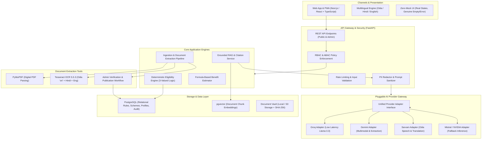

# Target State Architecture Specification

> **Target Release:** Udyog Sathi v1.0 (MVP)  
> **Status:** Architecture Blueprint  
> **Authority:** `00_MASTER_PROMPT.md` & `Udyog_Sathi_MSME_Odisha_Solution.pdf`  

---

## 1. Architectural Vision & Principles

Udyog Sathi is designed as an entrepreneur-centric, AI-assisted platform that serves as the single digital front door for MSMEs in Odisha. Instead of requiring entrepreneurs to navigate disconnected departmental portals, Udyog Sathi maps their verified business attributes to eligible schemes, explains requirements with traceable official citations, and guides them through the application lifecycle.

### Core Non-Negotiable Principles
1. **Zero Mock Production Data:** Every published scheme, rule, benefit formula, and document checklist is backed by official government documentation.
2. **Deterministic Eligibility First:** AI never guesses or hallucinates eligibility. Rules are evaluated using three-valued deterministic logic (`Eligible`, `Likely Eligible`, `Not Eligible`, `Rules Unverified`).
3. **Traceable Citations:** All RAG-generated text must cite the exact scheme name, official document title, section/page, and government URL.
4. **Honest System States:** When data, integrations, or credentials are unavailable, the system surfaces truthful empty states or error notices—never fake fallback data.
5. **₹0–₹100 Total Spend:** Built entirely with open-source tools, local runtimes, and verified free-tier API allocations.

---

## 2. Target Component Architecture

---

## 3. Deep Dive into System Layers

### 3.1 Data Ingestion, Extraction & Verification Pipeline
- **Candidate Source Allowlist:** Only approved domains (`msme.odisha.gov.in`, `odishamsme.nic.in`, `msme.gov.in`, `myscheme.gov.in`).
- **Extraction Mechanism:**
  - Fast digital extraction using `pymupdf` (fitz).
  - Automated scan-detection (character density check). Low-text pages route through `tesseract` with `-l ori+eng` or `-l hin+eng`.
- **Integrity & Auditing:** Every retrieved file is hashed with SHA-256 and stored alongside retrieval timestamp, source URL, and file size.
- **Verification Lifecycle:**
  $$\text{Discovered} \longrightarrow \text{Extracted} \longrightarrow \text{Pending Review} \longrightarrow \text{Verified} \longrightarrow \text{Published}$$
  - Unverified, draft, or failed documents are strictly excluded from public search and eligibility queries.
  - Reviewer actions record the reviewer ID, timestamp, and verification notes.

### 3.2 Database Schema & Storage (PostgreSQL + pgvector)
A modular relational schema enforces clean data isolation and auditability:
- `schemes`: Core scheme metadata (official ID, name in English and Odia, department, implementing agency, jurisdiction, status).
- `scheme_versions`: Tracks policy amendments, effective dates, expiry dates, and supersession links.
- `source_documents`: Source URLs, storage path, SHA-256 checksum, document type, publication date.
- `document_passages`: Extracted chunks, page numbers, section headers, dense vector embeddings (`vector(384)` or `vector(768)`).
- `eligibility_rules`: Structured rule conditions linked directly to source clause references and scheme versions.
- `benefit_formulas`: Formal calculation definitions (percentage, caps, duration, exclusions).
- `user_profiles`: MSME enterprise data (enterprise class, investment in plant/machinery, turnover, sector, district, caste category, gender, registration date).
- `application_records`: User-managed tracking records with explicit disclaimer that official submission occurs on government portals.
- `audit_logs`: Immutable append-only log of all data modifications, admin reviews, and authentication events.

### 3.3 Deterministic Eligibility Engine
The eligibility engine evaluates business profiles against structured scheme rules using three-valued logic:
1. **Conditions Definition:**
   - Operators: `=`, `!=`, `>`, `>=`, `<`, `<=`, `IN`, `NOT IN`, `CONTAINS`, `EXCLUDES`.
   - Facts: Enterprise Class, Sector, District, Investment Amount, Annual Turnover, Promoter Gender, Promoter Category, Commencement Date, Prior Beneficiary Flag.
2. **Evaluation Outcomes:**
   - `ELIGIBLE`: All rule conditions evaluate to `True`.
   - `LIKELY_ELIGIBLE`: No conditions evaluated to `False`, but one or more facts were missing (`Unknown`), generating targeted follow-up questions.
   - `NOT_ELIGIBLE`: One or more conditions evaluated to `False`. System outputs the exact failing condition and cited source clause.
   - `RULES_UNVERIFIED`: Scheme rules have not yet completed human verification.
3. **Benefit Estimation:**
   - Only calculated when verified formulas exist and all required numeric inputs are supplied.
   - Transparently displays underlying assumptions and limits.

### 3.4 Grounded RAG & Multi-Provider AI Gateway
- **Multi-Provider Adapter Interface:**
  - Common abstraction `LLMProvider` with standardized methods: `generate_completion()`, `stream_completion()`, `check_health()`.
  - Concrete adapters for:
    - **Groq:** Fast low-latency generation using Llama 3.3 70B Versatile.
    - **Google Gemini:** High-context document reasoning and extraction.
    - **Sarvam AI:** Odia language translation, speech-to-text (Saarika), and text-to-speech (Bulbul).
    - **Mistral / NVIDIA NIM:** Secondary backup providers.
- **Provider Resilience:**
  - Bounded request timeouts (default 15s).
  - Exponential backoff with maximum 2 retries.
  - Circuit breakers for rate-limiting (HTTP 429).
  - Explicit unavailable state when credentials are unset or providers fail—**no mock fallbacks**.
- **Grounded Citation Enforcement:**
  - RAG prompt instructs the model to generate responses strictly from retrieved passage context.
  - Every assertion must reference the scheme title, source document name, page number, and official URL.
  - When retrieved context is empty or irrelevant, the model must output an explicit disclaimer stating information cannot be verified from approved records.

### 3.5 Security, Privacy & RBAC
- **Identity & Roles:**
  - `entrepreneur`: Accesses only own profile, saved schemes, and applications.
  - `facilitator`: Time-bound, consent-gated access to specific client enterprises.
  - `scheme_reviewer`: Reviews and verifies extracted scheme rules and documents.
  - `platform_admin`: System configuration and health monitoring (no access to document vaults).
- **DPDP Act Compliance:**
  - Personal data minimization.
  - PII redaction (Aadhaar, PAN, phone numbers) before passing text to external AI APIs.
  - Consent records stored in database.
- **API Defense:**
  - CORS strictly configured to frontend origin.
  - Input validation via Pydantic v2 schemas.
  - Rate limiting on public and AI endpoints.

### 3.6 Frontend & User Experience
- **Framework:** Next.js / React with TypeScript.
- **Styling:** Highly responsive, accessible CSS system optimized for low-bandwidth mobile devices.
- **Multilingual Support:** English, Odia (with proper Odia Unicode fonts), and Hindi.
- **Truthful UI Components:**
  - Search directly queries database endpoints.
  - Scheme details display source provenance and verification status.
  - Real loading indicators, real pagination, and honest empty states.
  - Clearly visible disclaimer: *"Udyog Sathi is an advisory discovery platform. Official applications must be submitted via departmental portals."*

---

## 4. Cost Optimization Strategy (₹0–₹100 Budget)

| Resource | Target Technology / Tier | Expected Cost | Free-Tier Limits & Strategy |
|---|---|---|---|
| **Database** | PostgreSQL + pgvector (Local Docker / Supabase / Neon) | ₹0.00 | Free tier (up to 500MB storage, generous for structured scheme rules). |
| **Backend API** | FastAPI running on local uvicorn or Render / Railway free tier | ₹0.00 | Deploy on Render free tier (sleeps after 15 min inactivity, spin-up documented). |
| **Frontend** | Next.js on Vercel / Render / Cloudflare Pages | ₹0.00 | Generous free hosting on Vercel / Cloudflare. |
| **Embeddings** | Local `sentence-transformers` (`all-MiniLM-L6-v2` or `paraphrase-multilingual-MiniLM-L12-v2`) | ₹0.00 | Runs locally on CPU/Metal; zero API costs. |
| **OCR** | Tesseract OCR 5.5.3 local engine | ₹0.00 | Open-source local execution with pre-installed `ori` pack. |
| **LLM Inference** | Groq Free Tier / Gemini Developer Free API | ₹0.00 | Use free developer tier allocations; enforce daily budget counters. |
| **Total** | | **₹0.00** | Strict compliance with budget ceiling. |
